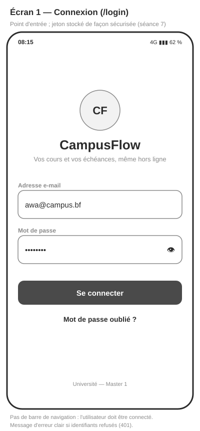
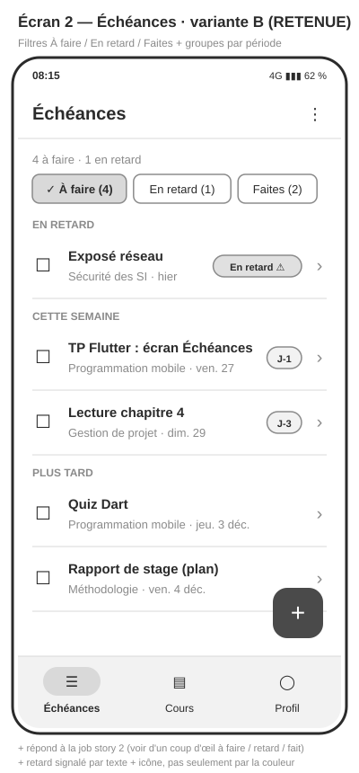
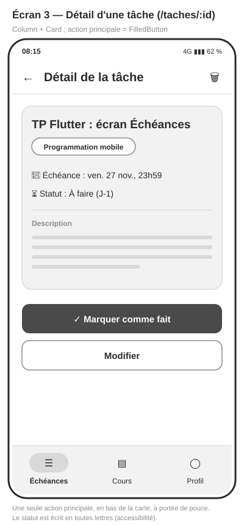
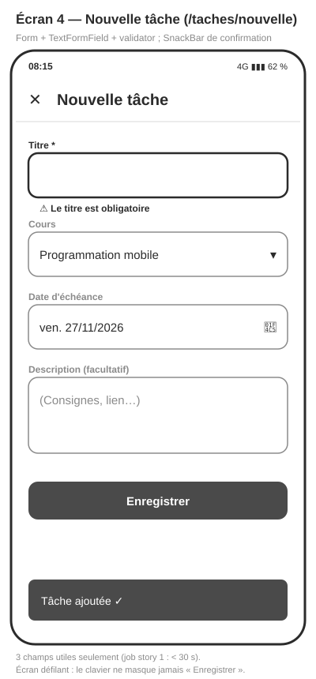
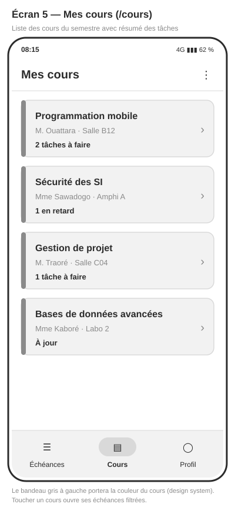
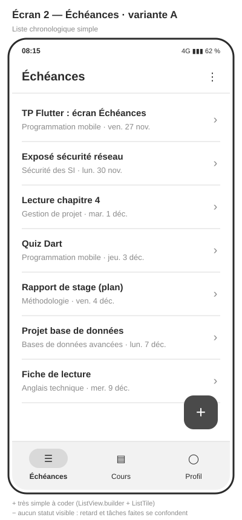
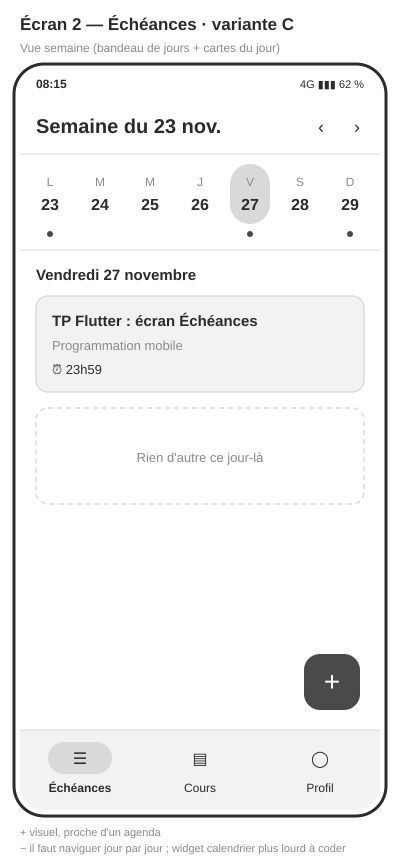

# Séance 2 — TP 6 : Wireframes

Cinq écrans en basse fidélité (gris, sans couleur ni image), au format téléphone 360 × 740 dp,
plus trois variantes de l'écran principal « Échéances ». Les fichiers SVG sont dans
[`wireframes/`](wireframes/). Les variantes ont été générées avec l'aide d'un outil d'IA ;
le choix final et sa justification sont les nôtres.

## Les cinq écrans

| # | Écran | Route prévue | Fichier |
|---|-------|--------------|---------|
| 1 | Connexion | `/login` | [01-connexion.svg](wireframes/01-connexion.svg) |
| 2 | Échéances (variante retenue B) | `/taches` | [02b-echeances-variante-B.svg](wireframes/02b-echeances-variante-B.svg) |
| 3 | Détail d'une tâche | `/taches/:id` | [03-detail.svg](wireframes/03-detail.svg) |
| 4 | Nouvelle tâche | `/taches/nouvelle` | [04-nouvelle-tache.svg](wireframes/04-nouvelle-tache.svg) |
| 5 | Mes cours | `/cours` | [05-cours.svg](wireframes/05-cours.svg) |

## Trois variantes de l'écran Échéances

| Variante A — liste simple | Variante B — filtres et groupes | Variante C — vue semaine |
|:---:|:---:|:---:|
|  |  |  |
| Toutes les tâches par date, une ligne chacune. | Filtres À faire / En retard / Faites, groupes par période, badges « J-1 » et « En retard ». | Bandeau des 7 jours, cartes du jour sélectionné. |

## Choix : variante B, justifiée avec la grille du cours

| Critère de la grille | A — liste simple | **B — filtres + groupes** | C — vue semaine |
|----------------------|------------------|---------------------------|-----------------|
| **Besoin** (job stories) | Partiel : on voit les dates mais pas le statut. | **Oui** : la job story 2 (« voir d'un coup d'œil à faire / en retard / fait ») est couverte par les trois filtres et le compteur. | Partiel : bonne vue d'un jour, mais pas de vue d'ensemble des retards. |
| **Parcours** (étapes Consulter et Rendre) | Consulter : oui. Rendre : la tâche faite reste mélangée aux autres. | **Consulter** en un écran ; **Rendre** : la tâche cochée bascule dans « Faites ». | Consulter impose de naviguer jour après jour ; un retard d'un jour passé est invisible. |
| **Accessibilité** | Correcte, mais aucun signal de retard. | **Bonne** : retard indiqué par un texte et une icône (pas seulement la couleur), cibles tactiles de 48 dp, police ≥ 13 sp. | Moyenne : chiffres de jours petits, points de couleur comme seul indicateur. |
| **Faisabilité** (Flutter, nos séances) | Très facile : `ListView.builder` + `ListTile`. | **Facile** : `ListView.builder` + `ListTile` (séance 5) et un fournisseur dérivé pour les filtres (séance 6). | Plus coûteuse : widget calendrier à coder ou paquet externe, gestion du jour sélectionné. |
| **Bilan** | Trop pauvre. | **Retenue.** | Séduisante mais hors besoin principal. |

**Décision :** nous retenons la **variante B**. Elle répond directement aux deux job stories,
reste réalisable avec les widgets prévus aux séances 5 et 6, et signale les retards sans
dépendre de la couleur. L'idée de la variante C n'est pas abandonnée : un bandeau semaine
pourra être ajouté plus tard au-dessus de la liste, si les tests utilisateurs le demandent.
