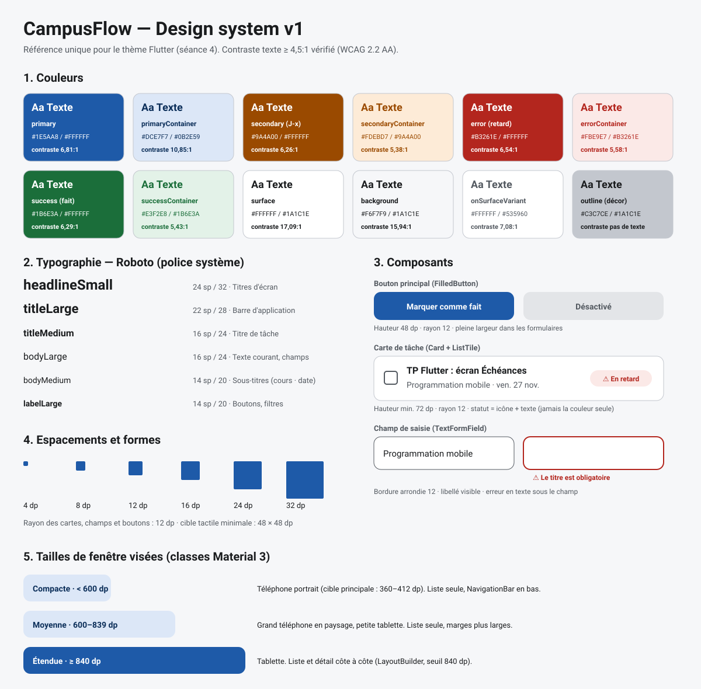

# Séance 2 — TP 7 : Design system v1

Page de référence unique, traduite en `ThemeData` Flutter à la séance 4
(`campusflow/lib/core/theme/`). Planche visuelle : [design-system-v1.svg](design-system-v1.svg).

## 1. Couleurs

Toutes les paires texte / fond ont été vérifiées avec la formule de luminance relative du WCAG
2.2 : chacune dépasse le **contraste minimal de 4,5:1** exigé pour le texte.

| Rôle (Material 3) | Couleur | Texte posé dessus | Contraste | Usage |
|-------------------|---------|-------------------|-----------|-------|
| `primary` | `#1E5AA8` bleu campus | `#FFFFFF` | 6,81:1 | Boutons principaux, élément actif |
| `primaryContainer` | `#DCE7F7` | `#0B2E59` | 10,85:1 | Filtre sélectionné, indicateur de navigation |
| `secondary` | `#9A4A00` ambre | `#FFFFFF` | 6,26:1 | Échéance proche (J-1, J-3) |
| `secondaryContainer` | `#FDEBD7` | `#9A4A00` | 5,38:1 | Badge « J-x » |
| `error` | `#B3261E` | `#FFFFFF` | 6,54:1 | Tâche en retard, erreurs de formulaire |
| `errorContainer` | `#FBE9E7` | `#B3261E` | 5,58:1 | Badge « En retard » |
| `success` *(extension)* | `#1B6E3A` | `#FFFFFF` | 6,29:1 | Tâche faite |
| `successContainer` *(extension)* | `#E3F2E8` | `#1B6E3A` | 5,43:1 | Badge « Faite » |
| `surface` | `#FFFFFF` | `#1A1C1E` | 17,09:1 | Cartes, barre d'application |
| fond d'écran (`scaffoldBackgroundColor`) | `#F6F7F9` | `#1A1C1E` | 15,94:1 | Fond des écrans |
| `onSurfaceVariant` | `#535960` sur `#FFFFFF` | — | 7,08:1 | Texte secondaire (cours · date) |
| `outline` | `#C3C7CE` | — | décor | Bordures et séparateurs uniquement, jamais du texte |

**Règle d'accessibilité :** un statut n'est jamais communiqué par la couleur seule ; il est
toujours accompagné d'un texte (« En retard », « J-1 », « Faite ») et d'une icône.

## 2. Typographie

Police **Roboto**, déjà présente sur Android : aucun fichier de police à télécharger, ce qui
respecte l'exigence de légèreté de la décision de plateforme (séance 1).

| Style Material 3 | Taille / interligne | Graisse | Usage |
|------------------|---------------------|---------|-------|
| `headlineSmall` | 24 / 32 sp | 700 | Titre de l'écran de connexion, titre du détail |
| `titleLarge` | 22 / 28 sp | 600 | Barre d'application |
| `titleMedium` | 16 / 24 sp | 600 | Titre d'une tâche dans la liste |
| `bodyLarge` | 16 / 24 sp | 400 | Texte courant, saisie dans les champs |
| `bodyMedium` | 14 / 20 sp | 400 | Sous-titres (cours · date) |
| `labelLarge` | 14 / 20 sp | 600 | Boutons, filtres |

Aucun texte n'est en dessous de 12 sp ; les tailles suivent le réglage de taille de police du
téléphone (pas de taille figée qui l'ignorerait).

## 3. Trois composants

### Bouton principal — `FilledButton`
- Hauteur 48 dp, rayon 12 dp, fond `primary`, libellé `labelLarge` blanc.
- Pleine largeur dans les formulaires et l'écran Détail.
- Un seul bouton principal par écran (« Se connecter », « Enregistrer », « Marquer comme fait »).
- État désactivé : fond gris `#E3E5E8`, texte `#535960`.

### Carte de tâche — `Card` + `ListTile`
- Hauteur minimale 72 dp, rayon 12 dp, fond `surface`, bordure `outline`.
- *Leading* : case à cocher (cible tactile 48 dp).
- *Title* : `titleMedium` ; *subtitle* : `bodyMedium` en `onSurfaceVariant` (« Cours · date »).
- *Trailing* : badge de statut (`errorContainer` + « ⚠ En retard », `secondaryContainer` +
  « J-1 », `successContainer` + « Faite »).

### Champ de saisie — `TextFormField`
- Bordure arrondie (`OutlineInputBorder`, rayon 12 dp), hauteur 56 dp.
- Libellé toujours visible ; champ obligatoire marqué d'un astérisque.
- Erreur : bordure `error` de 2 dp et message texte sous le champ (« Le titre est obligatoire »).

## 4. Espacements et formes

- Échelle d'espacement : **4, 8, 12, 16, 24, 32 dp**. Marge latérale des écrans : 16 dp.
- Rayon commun des cartes, champs et boutons : **12 dp**.
- Cible tactile minimale : **48 × 48 dp**.

## 5. Tailles de fenêtre visées

| Classe Material 3 | Largeur | Appareil | Mise en page CampusFlow |
|-------------------|---------|----------|--------------------------|
| Compacte | < 600 dp | Téléphone portrait (cible principale : 360–412 dp) | Liste seule, `NavigationBar` en bas |
| Moyenne | 600–839 dp | Grand téléphone en paysage, petite tablette | Liste seule, marges élargies |
| Étendue | ≥ 840 dp | Tablette | Liste et détail côte à côte (`LayoutBuilder`, seuil 840 dp, séance 5) |
